# Diagrama de clases

> Estado: TP5. Se actualiza en cada etapa con la estructura nueva.
> Una clase por estructura; solo se dibujan las que existen.

```mermaid
classDiagram

    class Lugar {
        -id: int
        -nombre: str
        -zona: str
        -categoria: str
        -puntuacion: float
        -horario_apertura: str
        -horario_cierre: str
        -costo: int
        +id() int
        +nombre() str
        +zona() str
        +categoria() str
        +puntuacion() float
        +horario_apertura() str
        +horario_cierre() str
        +costo() int
        +repr() str
    }

    class Salida {
        -id: int
        -nombre: str
        -participantes: list
        +id() int
        +nombre() str
        +participantes() list
        +repr() str
    }

    class Catalogo {
        -lugares: list
        -salidas: list
        -_claves: list
        -_arbol: ArbolBinarioBusqueda
        -_avl: ArbolAVL
        -_arbol_categorias: ArbolGeneral
        -_taxonomia: dict
        +cargar_desde_json(ruta) None
        +agregar_lugar(lugar) None
        +buscar(nombre) Lugar
        +ordenar_por_titulo() None
        +buscar_binaria(nombre) Lugar
        +indexar() None
        +buscar_arbol(nombre) Lugar
        +buscar_avl(nombre) Lugar
        +listar_ordenado() list
        +listar_preorder() list
        +listar_postorder() list
        +altura_arbol() int
        +altura_avl() int
        +comparar_bst_vs_avl() dict
        +cargar_categorias_desde_json(ruta) None
        +arbol_categorias() ArbolGeneral
        +buscar_nodo(texto) NodoGeneral
        +buscar_nodos(texto) list
        +ruta_de(nodo) str
        +lugares_de(nodo) list
        +lugares_de_rama(texto) list
        +describir_nodo(nodo) str
        +explorar_categorias(incluir_lugares) list
        +recorrer_categorias(orden, desde) list
        +buscar_parcial(texto) list
        +listar() list
        +cargar_salidas_desde_json(ruta) None
        +agregar_salida(salida) None
        +listar_salidas() list
        +filtrar(categoria) list
        +len() int
    }

    class NodoArbol {
        -_clave
        -_valor
        -_izquierdo
        -_derecho
        +clave()
        +valor()
        +izquierdo()
        +derecho()
        +repr() str
    }

    class ArbolBinarioBusqueda {
        -_raiz: NodoArbol
        -_clave: callable
        -_tamano: int
        +raiz() NodoArbol
        +insertar(valor) bool
        +buscar(clave)
        +contiene(clave) bool
        +inorder() list
        +preorder() list
        +postorder() list
        +altura() int
        +tamano() int
        +contains(clave) bool
        +len() int
        +bool() bool
        +repr() str
    }

    class NodoAVL {
        -_clave
        -_valor
        -_izquierdo
        -_derecho
        -_altura: int
        +clave()
        +valor()
        +izquierdo()
        +derecho()
        +altura() int
        +repr() str
    }

    class ArbolAVL {
        -_raiz: NodoAVL
        -_clave: callable
        -_tamano: int
        +raiz() NodoAVL
        +insertar(valor) bool
        +buscar(clave)
        +contiene(clave) bool
        +inorder() list
        +preorder() list
        +postorder() list
        +altura() int
        +factor_balance(nodo) int
        +esta_balanceado() bool
        +tamano() int
        +contains(clave) bool
        +len() int
        +bool() bool
        +repr() str
    }

    class NodoGeneral {
        -_etiqueta: str
        -_valor
        -_padre: NodoGeneral
        -_hijos: list
        +etiqueta() str
        +valor()
        +padre() NodoGeneral
        +hijos() tuple
        +grado() int
        +es_hoja() bool
        +repr() str
    }

    class ArbolGeneral {
        -_raiz: NodoGeneral
        -_clave_de: callable
        -_cantidad: int
        +raiz() NodoGeneral
        +agregar(padre, etiqueta, valor) NodoGeneral
        +eliminar(nodo) int
        +buscar(texto) NodoGeneral
        +buscar_profundidad(texto) NodoGeneral
        +buscar_todos(texto) list
        +contiene(texto) bool
        +camino(nodo) list
        +nivel(nodo) int
        +preorden(desde) list
        +postorden(desde) list
        +niveles(desde) list
        +por_niveles(desde) list
        +hojas(desde) list
        +altura() int
        +tamano() int
        +dibujar(desde, max_nivel, formato) list
        +contains(texto) bool
        +len() int
        +repr() str
    }

    class Terminal {
        -catalogo: Catalogo
        +iniciar() None
    }

    Terminal --> Catalogo : usa
    Catalogo "1" o-- "*" Lugar : contiene
    Catalogo "1" o-- "*" Salida : contiene
    Catalogo "1" *-- "1" ArbolBinarioBusqueda : indexa con (TP3)
    Catalogo "1" *-- "1" ArbolAVL : indexa con (TP4)
    ArbolBinarioBusqueda "1" *-- "*" NodoArbol : composed de nodos
    ArbolBinarioBusqueda "1" o-- "*" Lugar : ordena por nombre normalizado
    ArbolAVL "1" *-- "*" NodoAVL : composed de nodos
    ArbolAVL "1" o-- "*" Lugar : ordena por nombre normalizado
    Catalogo "1" *-- "1" ArbolGeneral : jerarquía de categorías (TP5)
    ArbolGeneral "1" *-- "*" NodoGeneral : composed de nodos
    NodoGeneral "1" --> "0..1" NodoGeneral : padre
    NodoGeneral "0..1" o-- "1" Lugar : valor (en las hojas)
```

## Qué cambió en cada etapa

| TP | Cambio en el diagrama |
|---|---|
| TP1 | `Lugar`, `Catalogo`, `Salida`, `Terminal` reales; `Salida` en versión mínima. |
| TP2 | `Catalogo` gana `_claves`, `ordenar_por_titulo()` y `buscar_binaria()`: la lista ordenada pasó a ser una segunda estructura de búsqueda. |
| TP3 | `Catalogo` gana `_arbol`, `indexar()`, `buscar_arbol()`, `listar_ordenado()`, `listar_preorder()`, `listar_postorder()` y `altura_arbol()`; aparecen `ArbolBinarioBusqueda` y `NodoArbol`. |
| TP4 | `Catalogo` gana `_avl`, `buscar_avl()`, `altura_avl()` y `comparar_bst_vs_avl()`; `indexar()` construye los dos árboles; aparecen `ArbolAVL` y `NodoAVL`. |
| TP5 | `Catalogo` gana `_arbol_categorias`, la carga de la jerarquía, las búsquedas por nodo, `ruta_de`, `lugares_de_rama`, `explorar_categorias` y `recorrer_categorias`; `indexar()` también arma el árbol general; aparecen `ArbolGeneral` y `NodoGeneral`. |

## Notas

- **`agregar_lugar()` mantiene los árboles al día.** Agrega el lugar a la lista y
  lo inserta en el BST y en el AVL en la misma operación, así que no hace falta
  llamar a `indexar()` después. Si el nombre ya estaba, `insertar` actualiza el
  nodo existente en vez de duplicarlo: la lista crece y los árboles no.

- **La lista no se reemplaza.** `Catalogo` sigue teniendo `_lugares` como lista y la
  sigue usando para `filtrar` y `buscar_parcial`, que son recorridos lineales. El
  árbol entra *al lado*, como índice de búsqueda exacta y como fuente del listado
  alfabético. La relación `Catalogo "1" *-- "1" ArbolBinarioBusqueda` muestra que
  hay uno solo por catálogo.
- **`ArbolBinarioBusqueda` es genérica.** Guarda la función de clave (`-_clave`) en
  vez de conocer a `Lugar`: el mismo árbol sirve para cualquier tipo. La relación
  `ArbolBinarioBusqueda --> Lugar` es por el uso concreto en este sistema, no una
  dependencia del código — `estructuras/arbol_binario.py` no importa nada de
  `servicios/` ni de `modelos/`.
- **`ArbolBST` en la plantilla de la consigna se llama acá `ArbolBinarioBusqueda`**,
  para dejar claro que no es un AVL ni un árbol general: no balancea y solo ordena
  por la clave inyectada.
- **`ArbolAVL` (TP4) tiene la misma API que `ArbolBinarioBusqueda`**, así que es un
  reemplazo directo. La diferencia es interna: cada `NodoAVL` guarda la altura de su
  subárbol y la inserción rebalancea con rotaciones para mantener
  `|altura(izq) − altura(der)| ≤ 1`. Eso garantiza altura O(log n) sin importar el
  orden de inserción, que es lo que el BST no puede prometer. Los dos árboles
  conviven en el `Catalogo` a propósito: el BST queda como término de comparación
  del TP4.
- `Salida` se incorporó en la v1 en su versión mínima (id, nombre y participantes) y
  se completa cuando se implementen RF04/RF05.
- **`ArbolGeneral` (TP5) no es un árbol de búsqueda.** No hay orden entre hermanos
  ni `inorder`: un nodo tiene cualquier cantidad de hijos y los recorridos son
  preorden, postorden y por niveles. Cada `NodoGeneral` guarda su **padre**, que
  el BST y el AVL no necesitaban, para calcular rutas y subir de nivel. Es
  genérico igual que los otros dos: `estructuras/arbol_general.py` no importa nada
  de `servicios/` ni de `modelos/`.
- **En el árbol de categorías, los `Lugar` son las hojas.** Los nodos internos
  (raíz, grupos, categorías) tienen `valor = None`; las hojas guardan el `Lugar`
  en `valor`. Por eso `NodoGeneral "0..1" o-- "1" Lugar`: es la **misma
  instancia** que está en la lista y en los otros dos árboles, no una copia.
- **`agregar_lugar()` también mantiene la jerarquía al día:** cuelga el lugar de su
  categoría (creándola bajo "Otros" si no existía), así que tampoco hace falta
  reindexar.
- **El diagrama PNG de `docs/capturas/` no se regeneró** con las clases del TP5:
  la fuente de verdad es el bloque Mermaid de este archivo.
