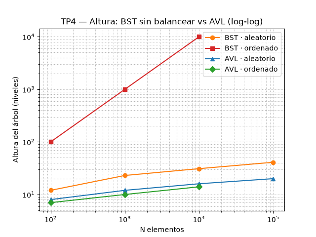

# TP4 — Árbol AVL

> Informe escrito como lo voy a explicar en la defensa: qué problema venía a
> resolver, qué implementé, qué medí y qué me salió. Los números son de la
> corrida que generó el gráfico y las alturas son deterministas.

## 1. La deuda que este TP viene a pagar

El TP3 terminó con una frase incómoda, escrita por nosotros mismos: **el BST no
garantiza O(log n)**. Solo lo garantiza *si* la altura se mantiene en O(log n), y
con claves ordenadas la altura es n. Lo sufrimos de verdad: al medir la
preparación, `ordenar_por_titulo()` dejaba la lista ordenada y `indexar()` metía
esas claves ya ordenadas en el árbol, que degeneraba en una lista enlazada de
altura 10.000. La búsqueda volvía a ser O(n) y el script tardaba 23 segundos
donde debía tardar milisegundos.

El TP4 no inventa una operación nueva. **Ataca exactamente esa debilidad**: la
misma estructura de búsqueda, la misma clave, la misma operación, pero
**rebalanceada con rotaciones**. La consigna lo pide en tres pasos que se
corresponden con las tres secciones de abajo: generar casos de desbalance,
implementar el AVL, y comparar BST contra AVL en esos casos.

## 2. La operación que comparo

La misma de los tres TP: **búsqueda exacta por nombre normalizado**
(`Catalogo.buscar_arbol` vs `Catalogo.buscar_avl`). No cambio la clave ni la
semántica a propósito, porque si cambiara algo, la comparación dejaría de ser
entre BST y AVL y pasaría a ser entre dos cosas distintas.

La diferencia con el TP3 no está en la operación, está en **cómo llegan los
datos**. En el TP3 medí el *tamaño* del catálogo; acá mido el *orden* de
inserción, que es la variable que rompe al BST y que el AVL debe neutralizar.

## 3. Qué implementé

En `estructuras/arbol_avl.py` hay dos clases, espejo de las del TP3.

`NodoAVL` es el nodo: `clave`, `valor`, los dos hijos y **la altura del
subárbol**. Ese último dato es lo que el BST no tenía. La altura se guarda en el
nodo (no se recalcula recorriendo el subárbol en cada consulta); al rotar se
actualiza en O(1), así que consultarla es O(1) y no un recorrido O(n).

`ArbolAVL` tiene la **misma API pública** que `ArbolBinarioBusqueda` —`insertar`,
`buscar`, `contiene`, los tres recorridos, `altura`, `tamano`, `__len__`,
`__bool__`, `__contains__`— más dos métodos de auditoría: `factor_balance(nodo)`
y `esta_balanceado()`. Que la API sea idéntica no es un detalle estético: hace
que el AVL sea un **reemplazo directo** del BST, y por eso el catálogo pudo
soportar los dos con un `lambda` de diferencia.

### 3.1 El invariante

Un AVL es un BST que además cumple:

> Para **todo** nodo, `|altura(izq) − altura(der)| ≤ 1`.

Ese número, `altura(izq) − altura(der)`, es el **factor de balance**. Positivo =
pesa la izquierda, negativo = pesa la derecha. Si algún nodo se sale del rango
`[-1, 1]`, la estructura deja de ser AVL y hay que rotar.

La consecuencia es la que importa para el TP: si todo nodo está a lo sumo un
nivel de diferencia, la altura no puede crecer linealmente. La cota conocida es:

> `h ≤ 1,44 · log₂(n + 2)`

para `n` nodos. Con 100.000 nodos eso es ~24 niveles. **Ese** es el O(log n)
garantizado que el BST del TP3 no tenía.

### 3.2 Las cuatro rotaciones

Una rotación es una operación local: reconecta tres punteros y deja el recorrido
in-order intacto (por eso el árbol sigue siendo BST), pero baja la altura. Hay
cuatro casos, y cada uno tiene un caso mínimo de tres claves:

| Caso | Claves que lo disparan | Qué se hace | Raíz que queda |
|---|---|---|---|
| Izquierda-izquierda | 30, 20, 10 | rotación simple a la derecha | 20 |
| Derecha-derecha | 10, 20, 30 | rotación simple a la izquierda | 20 |
| Izquierda-derecha | 30, 10, 20 | rotación izquierda al hijo y luego derecha | 20 |
| Derecha-izquierda | 10, 30, 20 | rotación derecha al hijo y luego izquierda | 20 |

Los dos últimos son las **rotaciones dobles**: el nieto se sube como nueva raíz
en dos pasos porque una sola rotación dejaría el árbol todavía torcido. La
inserción reconoce cuál de los cuatro aplica mirando el signo del factor de
balance del nodo y el de su hijo, y todas se resuelven en **O(1)**.

La inserción completa es: bajar por el camino de búsqueda (O(log n)), insertar
como hoja, y **al volver** actualizar alturas y rotar donde haga falta. La
recursión es la forma natural de hacer ese "al volver", y es el punto de la
próxima sección.

### 3.3 Por qué acá sí puedo usar recursión (y en el TP3 no)

El TP3 documentó que **todo** era iterativo por una razón concreta: un BST sin
balancear con claves ordenadas alcanza altura n, y con n = 100.000 una versión
recursiva se come el límite de recursión de Python (1000). Fue una decisión
defensiva.

En un AVL ese peligro **desaparece por construcción**. La recursión baja por el
camino de búsqueda, y ese camino mide exactamente la altura, que está acotada
por `1,44·log₂(n+2)`: ~24 niveles para 100.000 claves, ~29 para un millón.
Nunca se acerca al límite de 1000. Por eso `ArbolAVL._insertar` es recursivo con
tranquilidad, y el contraste con el TP3 es didáctico: **balancear no solo mejora
la complejidad, también hace segura la recursión**. Hay un test que lo fija:
insertar 5.000 claves ordenadas y verificar que la altura queda por debajo de 20
(en el BST esa misma inserción daría altura 5.000).

## 4. Cómo lo integré

El AVL entra como **cuarta estrategia de búsqueda exacta**, junto a la
secuencial (TP1), la binaria (TP2) y el BST (TP3):

- `Catalogo.indexar()` construye ahora **los dos** árboles, el BST y el AVL, con
  los mismos lugares y la misma clave.
- `Catalogo.buscar_avl(nombre)` tiene la misma firma y semántica que las otras
  tres: devuelve el mismo `Lugar` o `None`.
- `Catalogo.agregar_lugar(lugar)` inserta en ambos árboles.
- `Catalogo.altura_avl()` expone la altura, siempre logarítmica.
- La **opción 5 de la terminal** ahora ofrece las cuatro estrategias, y **la
  opción 6** es una demo pensada para la defensa: construye BST y AVL con el
  mismo catálogo insertado en orden alfabético y muestra altura y tiempo de
  cada uno.

Por qué conservo el BST en vez de borrarlo: **necesito el BST para poder
compararlo**. El entregable del TP es *la comparación*, no el AVL solo. Si
sacaba el BST perdía el término de comparación del propio TP4 y rompía la
continuidad de los números del TP2/TP3.

## 5. Cómo medí

Script nuevo: `python algoritmos/experimentos/medicion_avl.py`, y el gráfico con
`python algoritmos/experimentos/grafico_avl.py`.

La metodología es la del TP2/TP3 **sin cambios** (misma carga fuera del
cronómetro, mismo warm-up, mismo `timeit` 20 × 5 quedándome con el mínimo por
llamada). Lo que cambia es la variable independiente: en vez de variar
únicamente el tamaño, **varío el orden de inserción** manteniendo el dataset:

| Caso | Cómo genero los datos | Qué espero |
|---|---|---|
| `aleatorio` | mezclo los lugares (semilla fija) | el caso típico: el BST se porta bien |
| `ascendente` | ordeno por nombre normalizado | peor caso del BST: degenera a altura n |
| `descendente` | ordeno y doy vuelta | el espejo del anterior: también degenera |
| `casi_ordenado` | ordeno e intercambio ~1% de vecinos | el caso realista: casi tan malo como ordenado |

Mido, por caso y por tamaño: **altura**, **profundidad del peor caso** (el nodo
más profundo, que es la búsqueda más costosa), **tiempo de construcción** y
**tiempo de búsqueda** de esa clave más profunda.

### 5.1 Por qué recorté los tamaños degenerados a 10.000

Construir un BST con claves ordenadas es **O(n²)**: cada inserción nueva recorre
la cadena entera. A 10.000 son ~5·10⁷ comparaciones y el script ya tarda casi 10
segundos solo en esa construcción; a 100.000 serían minutos por corrida. Así que
los casos degenerados llegan hasta 10.000, mientras que el aleatorio llega hasta
100.000.

Esto no beneficia al AVL: la asimetría es en contra del BST (se lo mide en un
rango más chico), pero es el único modo de que el experimento corra. Y el efecto
aparece igual: con 10.000 elementos ordenados ya sobra para mostrar la
degeneración.

## 6. Resultados

### 6.1 El caso que rompe al BST: datos ordenados (ascendente)

| N | Altura BST | Altura AVL | Construir BST (ms) | Construir AVL (ms) | Buscar BST (ms) | Buscar AVL (ms) |
|---:|---:|---:|---:|---:|---:|---:|
| 100 | **100** | 7 | 1,86 | 2,59 | 0,0334 | 0,0031 |
| 1.000 | **1.000** | 10 | 109,74 | 21,75 | 0,1207 | 0,0027 |
| 10.000 | **10.000** | 14 | 9.668,08 | 152,13 | 1,5202 | 0,0019 |



Acá está toda la tesis del TP. La altura del BST es **exactamente n**: con 10.000
lugares ordenados el árbol es una lista enlazada de 10.000 niveles, mientras que
el AVL se queda en **14**. La búsqueda del peor caso pasa de **1,52 ms** a
**0,0019 ms**, o sea el AVL es unas **800 veces** más rápido, y la construcción
pasa de **9,7 s** a **0,15 s** (unas **64 veces**). No es una mejora de
constante: es el O(n²)/O(n) del BST contra el O(n log n)/O(log n) del AVL.

### 6.2 Descendente y casi ordenado: el problema no era "ascendente"

| Caso | N | Altura BST | Altura AVL | Construir BST (ms) | Buscar BST (ms) | Buscar AVL (ms) |
|---|---:|---:|---:|---:|---:|---:|
| descendente | 10.000 | **10.000** | 14 | 9.411,00 | 1,5345 | 0,0019 |
| casi_ordenado | 10.000 | **9.900** | 14 | 9.222,51 | 1,3926 | 0,0018 |

Dos conclusiones que me importan. La primera: **descendente degenera igual** que
ascendente; el BST no falla por "orden ascendente", falla por **orden en
general**. La segunda: `casi_ordenado` da altura 9.900 sobre 10.000, o sea el
**99% de n**. No hace falta que los datos lleguen perfectamente ordenados: si
llegan *casi* ordenados —que es lo que pasa cuando se exporta un catálogo desde
cualquier sistema que ya lo tenía ordenado— el BST ya está prácticamente
degenerado. El AVL, en cambio, da 14 en los tres casos.

### 6.3 El caso donde el BST se porta bien: aleatorio

| N | Altura BST | Altura AVL | Construir BST (ms) | Construir AVL (ms) | Buscar BST (ms) | Buscar AVL (ms) |
|---:|---:|---:|---:|---:|---:|---:|
| 100 | 12 | 8 | 0,39 | 1,02 | 0,0022 | 0,0015 |
| 1.000 | 23 | 12 | 5,28 | 14,01 | 0,0043 | 0,0022 |
| 10.000 | 31 | 16 | 66,20 | 172,17 | 0,0052 | 0,0021 |
| 100.000 | 41 | 20 | 1.042,10 | 2.481,35 | 0,0068 | 0,0103 |

Acá aparece el **precio** del AVL, y no lo voy a esconder: con datos aleatorios
el AVL **construye más lento** (2.481 ms contra 1.042 ms a 100.000, unas 2,4
veces) porque tiene que recalcular alturas y rotar; y en las búsquedas de esta
tabla no se ve una ventaja clara (0,0103 ms contra 0,0068 ms), porque cuando los
datos vienen desordenados el BST ya queda razonablemente balanceado por azar
(altura 41 contra la cota 24 del AVL) y **dominan las constantes y el ruido** a
escala de microsegundos.

O sea: el AVL **no es gratis**. Su ventaja no es "es más rápido siempre", es
**"es rápido siempre"**. En el caso típico paga overhead; en el caso patológico
es la diferencia entre funcionar y no funcionar.

### 6.4 Cómo crece la altura

| N | Árbol perfecto (⌈log₂(n+1)⌉) | BST aleatorio | BST ordenado | AVL |
|---:|---:|---:|---:|---:|
| 100 | 7 | 12 | 100 | 8 |
| 1.000 | 10 | 23 | 1.000 | 12 |
| 10.000 | 14 | 31 | 10.000 | 16 |
| 100.000 | 17 | 41 | — | 20 |

La columna del AVL crece **+4 o +5** cada vez que N se multiplica por 10: es la
firma de un logaritmo. La del BST ordenado **se multiplica por 10**, que es la
firma de una recta. La del BST aleatorio crece como log n, pero por casualidad
de los datos, no por garantía de la estructura: es exactamente el matiz que
separa el TP3 del TP4.

## 7. Análisis de complejidad

| Estructura | Búsqueda mejor Ω | Búsqueda peor O | Construcción (n inserciones) | Altura |
|---|---|---|---|---|
| BST del TP3 | Ω(1): está en la raíz | **O(n) si degenera**; O(log n) si está balanceado | O(n log n) típico, **O(n²) si degenera** | O(log n) típico, **O(n) peor** |
| AVL del TP4 | Ω(1): está en la raíz | **O(log n) garantizado** | **O(n log n) garantizado** | **O(log n) garantizado** |

Cada inserción en el AVL hace un camino de altura `h` y a lo sumo **una** (o una
doble) rotación, que es O(1). Entonces insertar es `O(1) + O(h) = O(log n)`, y
construir el árbol con n inserciones es `O(n log n)` **en el peor caso**, no solo
en promedio. La búsqueda recorre a lo sumo `h = O(log n)` nodos. Y `h` está
acotada por `1,44·log₂(n+2)` sin importar cómo llegaron las claves: **la
garantía no depende del orden de inserción**, que es justo lo que el BST no
podía prometer.

## 8. La lectura honesta: garantía contra constantes

El TP3 ya había dejado una lección: en Python el BST pierde contra `bisect`
porque `bisect` es código C. El TP4 agrega una segunda capa a esa lección.

El AVL **no le gana a `bisect`** en búsqueda, y con datos aleatorios **es más
lento que el BST** en construcción. Sería tentador vender el AVL como "el árbol
bueno", pero la medición dice algo más fino:

1. Contra el BST en el caso **patológico** (datos ordenados), el AVL gana por
   **complejidad**: O(log n) contra O(n) en búsqueda, y O(n log n) contra O(n²)
   en construcción. Con 10.000 elementos son ~800× y ~64× respectivamente, y la
   brecha **crece** con n.
2. Contra el BST en el caso **típico** (datos aleatorios), el AVL **paga** el
   rebalanceo (2,4× más lento en construcción) y no gana en búsqueda.
3. Contra `bisect`, sigue ganando la lista ordenada, por las mismas razones de
   constantes del TP2/TP3.

Entonces, ¿para qué el AVL? Para tener una estructura **dinámica** (inserción en
O(log n), sin reordenar nada) que además sea **robusta al orden de los datos**.
Ese es el trade-off real: el AVL cambia un poco de overhead constante por una
garantía asintótica. Para un catálogo que se carga desde un JSON y después se
consulta, la lista ordenada sigue siendo la mejor opción; para un catálogo que
crece con inserciones que pueden llegar ordenadas, el AVL es la opción que no
depende de la suerte.

## 9. El mini ejemplo de la consigna

Insertar títulos en orden alfabético en un BST común degenera en una lista
enlazada: la raíz es el primero alfabéticamente, su único hijo es el segundo, y
así sucesivamente. Buscar el último deja que recorrer **n** nodos → O(n). El
mismo dataset en un AVL reconoce el patrón `izquierda-izquierda` en cada
inserción y rota: la raíz termina cerca del título del medio y la altura queda
en `log₂ n`. La demo de la opción 6 lo muestra en vivo con los 50 lugares reales:
**BST altura 50, AVL altura 6**. No es que el AVL "sea más rápido": es que la
búsqueda del BST se degradó a lo mismo que recorrer una lista.

## 10. Conclusión

1. **Qué comparé**: la misma operación (búsqueda exacta por nombre) en la misma
   estructura base, BST contra AVL, variando el **orden** de inserción sobre los
   mismos datos y con la metodología de medición de los TP2/TP3.
2. **Qué dice la tabla**: con datos ordenados la altura del BST es n y la del
   AVL es log₂ n; a 10.000 elementos la búsqueda del BST tarda 1,52 ms contra
   0,0019 ms del AVL (~800×) y su construcción 9,7 s contra 0,15 s (~64×).
3. **Por qué**: el AVL mantiene `|altura(izq) − altura(der)| ≤ 1` con rotaciones
   O(1), así que su altura queda acotada por `1,44·log₂(n+2)`. El BST no tiene
   esa garantía y, con claves ordenadas, degenera a una lista de altura n.
4. **Qué cuesta**: el AVL no es gratis. Con datos aleatorios construye ~2,4×
   más lento que el BST. Su ventaja no es ser rápido siempre *más*, es ser
   rápido siempre *igual*, sin importar cómo lleguen los datos.
5. **Qué aprendí**: la complejidad asintótica no se ve en el caso típico. El BST
   y el AVL se parecen con datos aleatorios y se separan por completo con datos
   ordenados. La garantía del AVL es lo que convierte el "promedio" del TP3 en
   un "peor caso" acotado, y eso es lo que un sistema en producción necesita.

**Párrafo modelo para la defensa**

> "El TP3 dejó una deuda: el BST solo es O(log n) si la altura está en O(log n),
> y con claves ordenadas la altura es n. En el TP4 medimos esa degeneración —a
> 10.000 lugares ordenados el BST queda con altura 10.000, es una lista
> enlazada, y buscar cuesta 1,52 ms contra 0,0019 ms del AVL, 800 veces menos— y
> la resolvimos con un AVL, que con rotaciones de costo O(1) mantiene
> `|factor de balance| ≤ 1` y la altura acotada por `1,44·log₂ n`. El AVL no es
> más rápido siempre: con datos aleatorios construye 2,4 veces más lento que el
> BST. Su valor es que la garantía no depende del orden de inserción: cambia
> overhead constante por complejidad garantizada, y eso es lo que el BST no
> podía dar."

*(Nota al margen: los tiempos absolutos dependen de la máquina y varían entre
corridas; lo que es determinista —y por lo tanto lo que hay que defender— son
las alturas, el patrón de crecimiento y el script commiteado que genera todo.
Las búsquedas en el rango de microsegundos, donde las tablas se cruzan, están
dominadas por el ruido y no se deben leer como diferencias de complejidad.)*

## Reproducción

```bash
python datos/generar.py                        # datasets sintéticos (si no existen)
python algoritmos/experimentos/medicion_avl.py # tablas BST vs AVL por orden de inserción
python algoritmos/experimentos/grafico_avl.py  # guarda docs/capturas/experimento-tp4.png
python main.py                                 # opción 6: demo BST vs AVL
python -m unittest discover tests              # 112 pruebas
```
